# 9. Database Architecture & ERD (Migrations 0001–0055)

**Total Migrations:** 57 SQL files (`0001` through `0056`, including dual `0002_*`)  
**PostgreSQL Parity:** `rticore_postgresql_schema.sql` (191 tables) + `rticore_postgresql_triggers.sql` (295 PL/pgSQL triggers generated via `scripts/generate-postgres-triggers.mjs`, verified by `npm run test:pg-triggers`).

## Domain Entity Relationships

```mermaid
erDiagram
  rticore_erp_org_units ||--o{ rticore_erp_staff_org : "assigns"
  rticore_erp_org_units ||--o{ rticore_service_catalog_v2 : "owns"
  rticore_service_catalog_v2 ||--o{ rticore_service_activity_templates : "breaks_into_12_phases"
  rticore_service_catalog_v2 ||--o{ rticore_historical_effort_benchmarks : "calibrates"
  rticore_erp_org_units ||--o{ rticore_enterprise_rate_cards : "governs_19_roles"
  rticore_erp_org_units ||--o{ rticore_pricing_scenarios : "simulates"
  rticore_pricing_scenarios ||--o{ rticore_pricing_snapshots : "freezes_immutable"
  rticore_erp_org_units ||--o{ rticore_flexguard_packages : "configures"
  rticore_sales_accounts ||--o{ rticore_flexguard_credit_lots : "holds"
  rticore_sales_accounts ||--o{ rticore_flexguard_enterprise_ledger : "posts_immutable"
  rticore_sales_accounts ||--o{ rticore_flexguard_service_requests : "requests"
  rticore_flexguard_service_requests ||--o{ rticore_flexguard_sla_events : "tracks_sla"
  rticore_flexguard_enterprise_ledger ||--o| rticore_finance_integration_events : "emits_outbox"
  rticore_erp_org_units ||--o{ rticore_cti_cases : "investigates"
  rticore_cti_cases ||--o{ rticore_cti_iocs : "contains"
  rticore_erp_org_units ||--o{ rticore_grc_engagements : "advises"
  rticore_erp_org_units ||--o{ rticore_enterprise_risk_register : "tracks"
  rticore_erp_org_units ||--o{ rticore_enterprise_control_register : "tests_with_SoD"
```

## Non-Negotiable Data Integrity Rules
- All monetary values use integer minor units (`_cents`, `BIGINT` in PostgreSQL); zero floating-point arithmetic.
- All financial, pricing snapshot, FlexGuard ledger, risk, control, and backup drill tables enforce `BEFORE DELETE` immutability triggers.
- Every legal-entity-scoped table carries `(tenant_id, legal_entity_id)` foreign key to `rticore_erp_org_units`.
